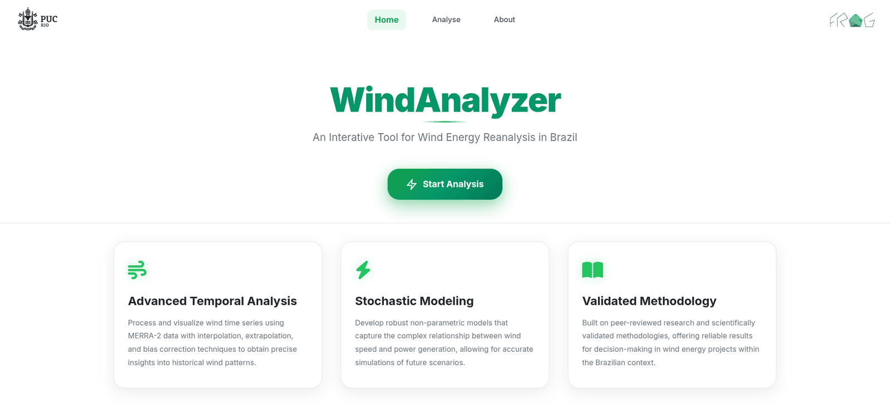
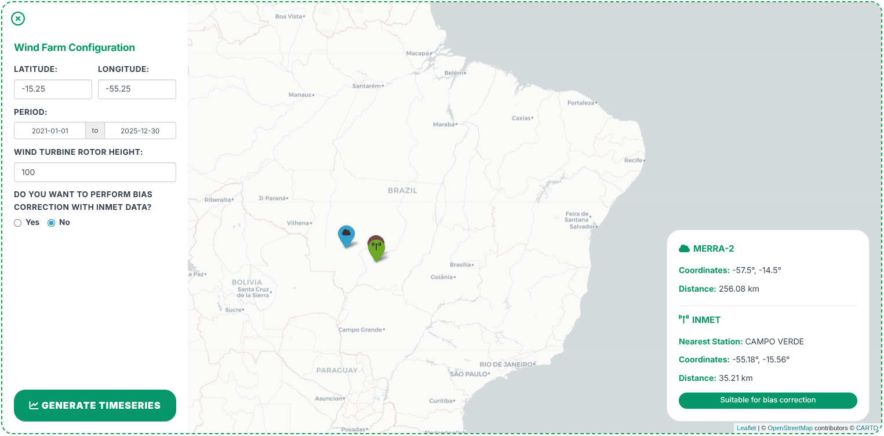
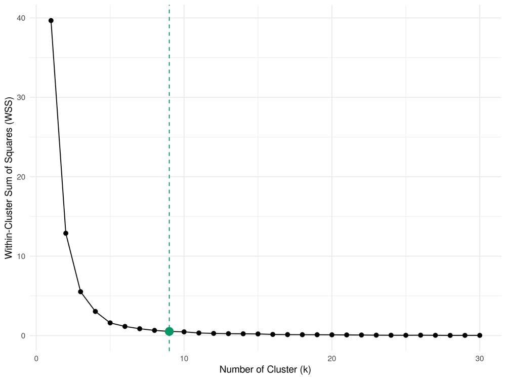
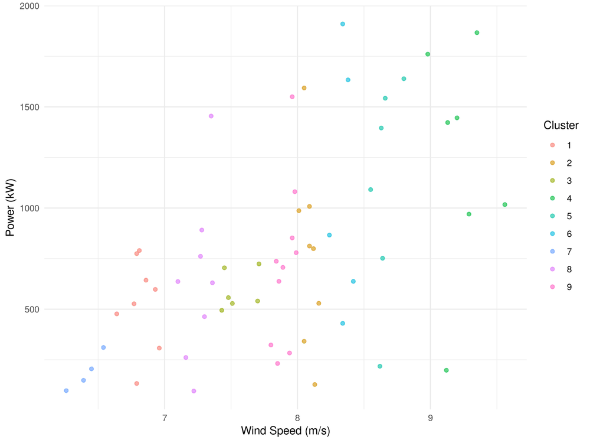
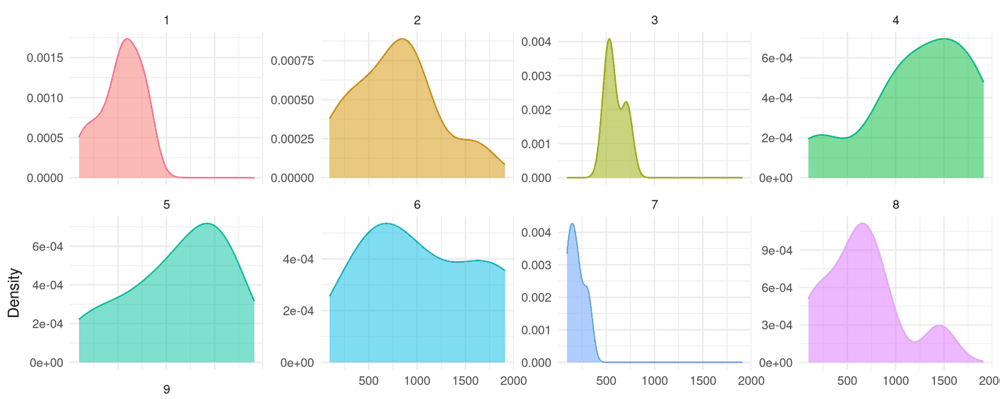
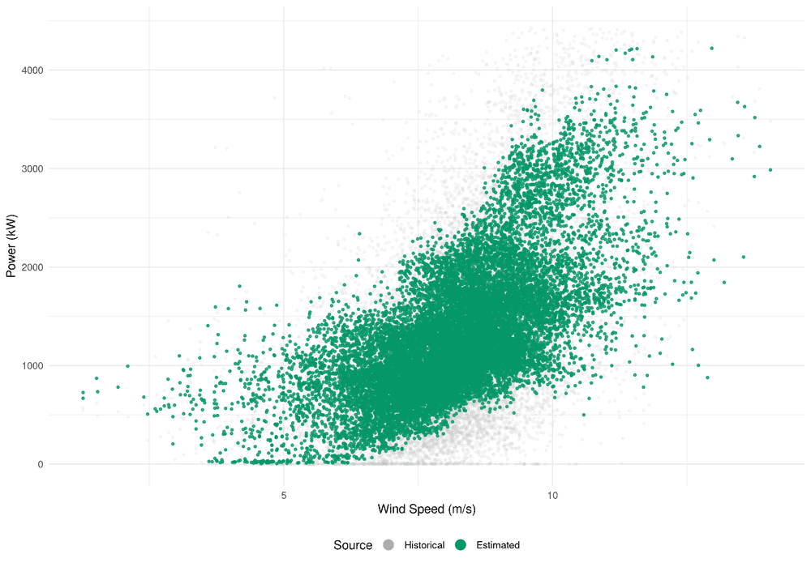
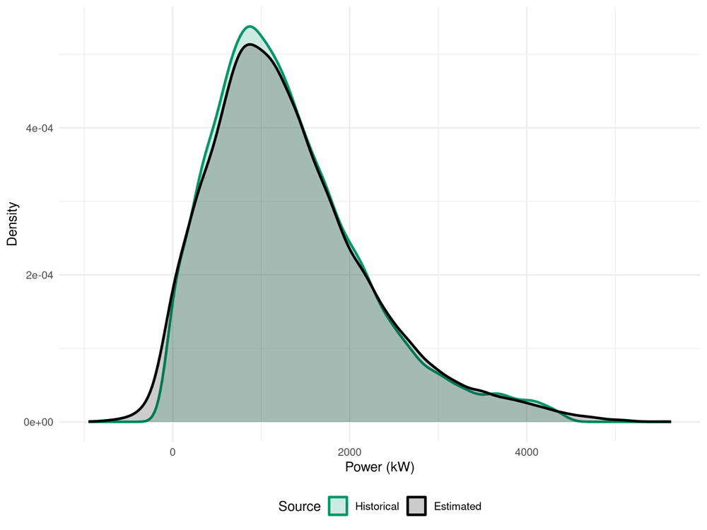
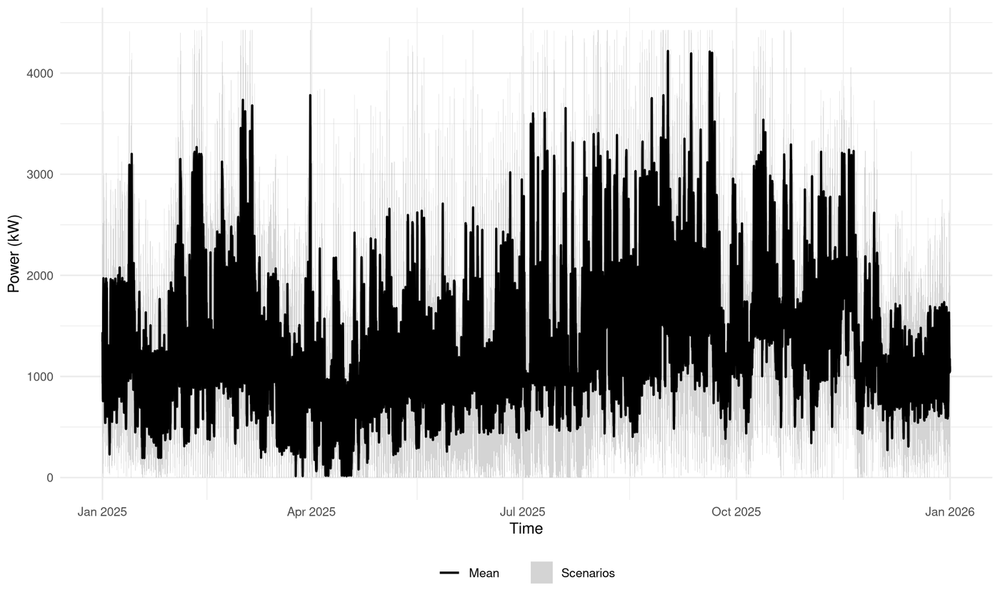

<div align="center">

# WindAnalyzer

**A computational tool for nonparametric modeling and validation of wind energy data in Brazil**

[](https://paulamacaira.shinyapps.io/WindAnalyzer/)


[**Open the app →**](https://paulamacaira.shinyapps.io/WindAnalyzer/)



</div>

WindAnalyzer is a decision-support web application, built in R/Shiny, that turns two peer-reviewed methodologies into an interactive pipeline:

1. **Reliable wind speed series anywhere in Brazil** — hourly MERRA-2 reanalysis data, interpolated to the nearest grid point, extrapolated to the turbine rotor height and optionally bias-corrected against INMET weather stations ([Ferreira et al., 2022](https://doi.org/10.1016/j.energy.2022.124746)).
2. **Joint speed–power modeling without the manufacturer's power curve** — K-means clustering of wind regimes, Kernel Density Estimation of the power distribution within each regime, and Monte Carlo simulation of generation scenarios ([Ferreira et al., 2024](https://doi.org/10.3390/en17143573)).

The manufacturer's power curve describes a single turbine under ideal conditions; it ignores wake effects between turbines and site-specific atmospheric conditions. WindAnalyzer learns the speed–power relationship from the wind farm's own history and produces **probabilistic** generation projections (mean trajectory and 90% confidence band) instead of a single deterministic estimate.

> Developed at the Department of Industrial Engineering (DEI) of PUC-Rio as an undergraduate research project (PIBIC).

---

## How it works

### Stage 1 — Wind speed series

Two input modes:

- **Upload your own series** (e.g. from an anemometric tower) as CSV, with configurable header, column separator and decimal mark.
- **Generate it from MERRA-2.** Pick a location on the map, the period and the rotor height. The app finds the nearest MERRA-2 grid point and INMET station, and runs the processing chain:
  - wind speed from the vector components at 10 m and 50 m, $v = \sqrt{U^2 + V^2}$;
  - vertical extrapolation to rotor height $h_r$ by the Hellman power law, with the friction exponent estimated from the logarithmic profile corrected by the zero-plane displacement height (DISPH):

    $$v(h_r) = v(50)\left(\frac{h_r}{50}\right)^{\alpha}, \qquad \alpha = \frac{\ln v(50) - \ln v(10)}{\ln 50 - \ln(10 + \text{DISPH})}$$

  - optional mean-ratio bias correction against the nearest INMET station (single-period, monthly, hourly or monthly-hourly factors), after filtering physically inconsistent readings (outside 0–25 m/s).



### Stage 2 — Joint speed–power modeling

The speed series is paired in time with the farm's historical power series and modeled under one of four temporal stratifications: **single period, monthly, hourly or monthly-hourly**. For each subgroup:

| Step | What happens |
|---|---|
| **Automatic choice of K** | K-means runs for K = 1…30; the elbow criterion picks the smallest K after which the normalized reduction in within-cluster SSE falls below 0.1%. Clusters with fewer than 4 observations reduce K. |
| **K-means clustering** | Each cluster becomes a wind speed band (min/max speed and centroid). |
| **KDE per cluster** | The empirical PDF of the generated power in each band is estimated with a Gaussian kernel. |

| Elbow criterion | Speed–power clusters |
|---|---|
|  |  |



### Validation

A Monte Carlo simulation with 100 scenarios over the historical period compares the estimated power with the observed power, both in the speed–power plane and in distribution.

| Historical vs. estimated (speed × power) | Power density: historical vs. estimated |
|---|---|
|  |  |

### Stage 3 — Probabilistic projection

Given a future wind speed series and a number of scenarios, each observation is assigned to its cluster (and month/hour, when stratified) and power values are sampled from that cluster's KDE. Speeds outside the historical bands go to the nearest cluster. The output is the mean trajectory with a 90% band (5th–95th percentiles).



---

## Architecture

The app follows the **Shiny Modules** pattern: each functional block has its own UI/server pair and namespace. Reactive state lives in `reactiveValues`, and the heavy pipeline (clustering → KDE → Monte Carlo) only runs on an explicit `eventReactive` trigger, with intermediate results cached for all downstream charts.

```
WindAnalyzer/
├── app.R                    # entry point: loads data, sources R/, builds the UI and server
├── R/
│   ├── modules/             # pages and features (Shiny modules)
│   │   ├── nav_bar.R  hero.R  cards_sect.R  about.R
│   │   ├── map_input.R      # Leaflet map, MERRA-2 / INMET lookup, series generation
│   │   └── analysis.R       # upload → modeling → validation → projection
│   ├── components/          # reusable UI pieces (charts, custom file input, guide banner)
│   └── utils/               # algorithms and data access
│       ├── cluster.R        # K-means + automatic K (elbow)
│       ├── kde.R            # KDE models, Monte Carlo sampling, cluster lookup
│       ├── map_tseries_utils.R        # MERRA-2 series, extrapolation, bias correction
│       ├── map_interpolation_utils.R  # nearest-neighbor (great-circle distance)
│       ├── time_series.R    # pairing of speed and power series
│       ├── setup_file_observer.R      # CSV reading with user-defined options
│       └── dropbox_utils.R  # credentials, OAuth 2.0 token refresh, remote .feather download
├── data/                    # static datasets loaded at startup
│   ├── lonlat_modificado.feather   # MERRA-2 grid coordinates
│   ├── MerraDate.feather           # MERRA-2 hourly time index (2000-01 → 2023-11)
│   ├── Base_estacoes.RData         # INMET station inventory
│   └── Base_Dados_Estacoes.RData   # INMET hourly wind series
├── www/                     # CSS, JS, images and the user guide (PDF)
├── docs/images/             # screenshots used in this README
├── renv.lock                # pinned package versions
└── .Renviron.example        # template for the Dropbox credentials
```

### Data layer: remote access to MERRA-2

Loading the full MERRA-2 grid for Brazil into memory is not feasible. The reanalysis was pre-processed and split into **one Apache Feather file per grid point** (U/V wind components at 10 m and 50 m, plus DISPH), stored in the cloud. At runtime the app authenticates through **OAuth 2.0 with automatic token refresh** and downloads only the file for the requested grid point. The small auxiliary datasets (grid coordinates and INMET inventory) stay in memory for the whole session.

---

## Running locally

**Requirements:** R ≥ 4.3 (the lockfile was generated with R 4.5) and the packages pinned in `renv.lock`.

```r
# 1. Restore the package library (renv bootstraps itself through .Rprofile)
renv::restore()

# 2. Run the app
shiny::runApp()
```

**MERRA-2 access.** Generating series from the map requires credentials for the Dropbox app that hosts the grid files. Copy `.Renviron.example` to `.Renviron` and fill in:

```
DROPBOX_REFRESH_TOKEN=...
DROPBOX_CLIENT_ID=...
DROPBOX_CLIENT_SECRET=...
```

A legacy `config_token.R` (defining `refresh_token`, `client_id` and `client_secret`) is also accepted. Both files are git-ignored. Without credentials the app still starts and the upload-based workflow works; only map-based series generation is unavailable.

<<<<<<< HEAD
=======
**Basemap.** The map uses CARTO's Positron tiles, which require a free API key for non-commercial use ([request one here](https://carto.com/basemaps/apikey)). Add it to `.Renviron` as `CARTO_API_KEY=...`. Without a key, the map falls back to OpenStreetMap tiles.

>>>>>>> 97f91d037ee3f57bf4668a5846599aabd1d44f60
### Input file formats

All uploads are CSV files. The header, column separator (`;`, `,` or tab) and decimal mark (`.` or `,`) are set in the ⚙ dialog next to each upload field.

| Upload | Columns (in this order) |
|---|---|
| Historical wind speed | date (`YYYY-MM-DD`, `DD/MM/YYYY` or `MM/DD/YYYY`), hour (0–23), speed (m/s) |
| Historical power | date, hour (0–23), power (kW) |
| Future wind speed (projection) | date, hour, speed — or datetime, speed |

The speed and power series are joined on the hourly timestamp. A step-by-step guide is available inside the app (**Download Guide**) and in [`www/WindAnalyzer_Guide.pdf`](www/WindAnalyzer_Guide.pdf).

---

## Research context

WindAnalyzer was developed at PUC-Rio's Department of Industrial Engineering. It brings together the methodologies of:

- S. C. Ferreira, F. L. Cyrino Oliveira, P. M. Maçaira. *Validation of the representativeness of wind speed time series obtained from reanalysis data for Brazilian territory.* **Energy**, 258:124746, 2022. [doi:10.1016/j.energy.2022.124746](https://doi.org/10.1016/j.energy.2022.124746)
- S. C. Ferreira, P. M. Maçaira, F. L. Cyrino Oliveira. *Joint modeling of wind speed and power via a nonparametric approach.* **Energies**, 17(14):3573, 2024. [doi:10.3390/en17143573](https://doi.org/10.3390/en17143573)

Data sources: [MERRA-2](https://gmao.gsfc.nasa.gov/reanalysis/MERRA-2/) (NASA GMAO) and [INMET](https://portal.inmet.gov.br/) weather stations.

### Authors

Saulo Custodio, Fernando Cyrino, Paula Maçaira, Gabriel Rosas and Gustavo Melo — Pontifícia Universidade Católica do Rio de Janeiro (PUC-Rio).

Software development: [Gabriel Rosas](https://www.linkedin.com/in/gabriellsar/), advised by Prof. Fernando Luiz Cyrino Oliveira and Gustavo de Andrade Melo.

### Citation

If you use WindAnalyzer, please cite the two papers above. Citation metadata for the software is in [`CITATION.cff`](CITATION.cff).

## License

A license has not been chosen yet. The software registration with INPI is in progress.
